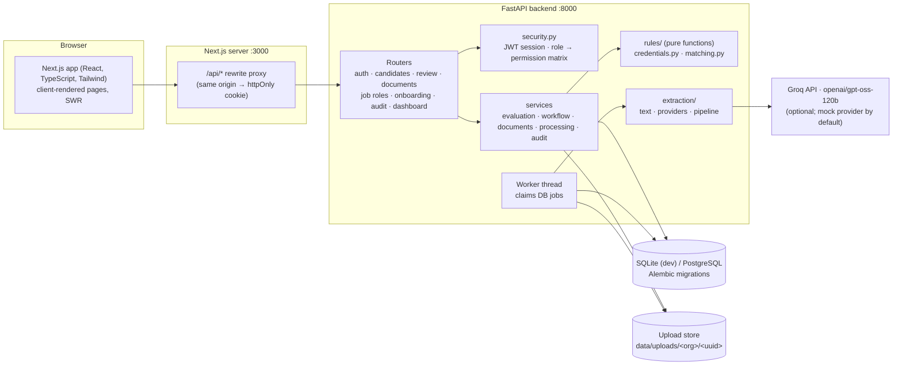
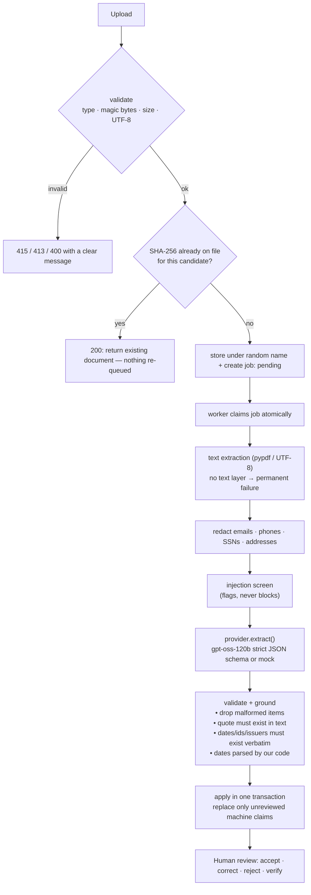
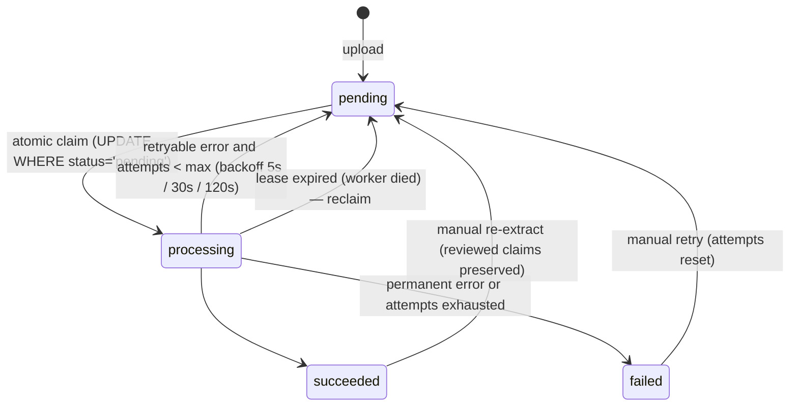
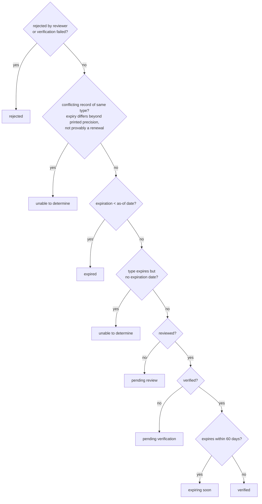
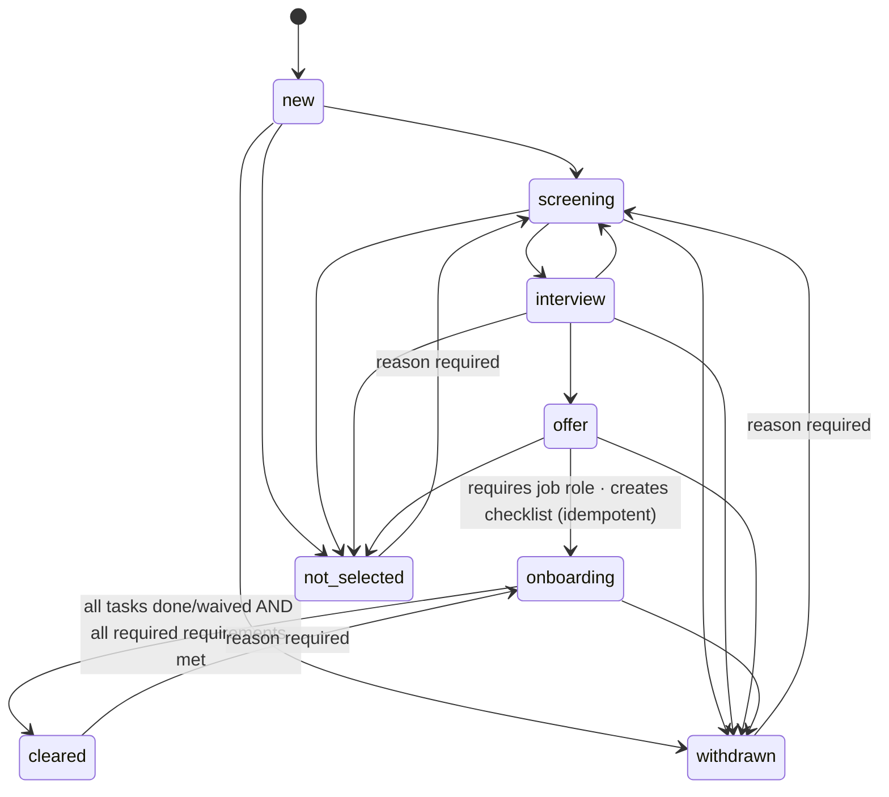

# Architecture

HealthForce Intelligence is a recruiter/reviewer workflow application. AI is a single, bounded
component (document → candidate facts with quotes). Everything that decides something — credential
status, requirement outcomes, eligibility, scores, blockers, next actions — is deterministic code
over human-reviewed data.

## System overview

### Component boundaries

| Layer | Responsibility | Must not |
|---|---|---|
| `app/rules/` | Credential status, conflict detection, requirement outcomes, eligibility, score, next actions | touch the DB, the clock (as-of date is a parameter) or any AI |
| `app/extraction/` | File validation, text extraction, PII redaction, injection screening, provider calls, **grounding** | write to the DB or decide statuses |
| `app/services/` | Transactions, tenancy-scoped loading, applying extraction results, workflow guards, audit records | contain HTTP concerns |
| `app/api/` | Input validation, permission checks, response shaping | contain business rules |
| `frontend/` | Presentation, URL-synced filters, optimistic UX | enforce security (every check is repeated server-side) |

## Document pipeline

### Job state machine

Idempotency anchors: one job row per document (unique `document_id`); `process_job` is a no-op unless
the job is in `processing`; duplicate bytes per candidate are rejected by a unique constraint; re-applying
results deletes only *unreviewed machine* claims of that document and skips claims identical to
reviewed ones.

## Why the model cannot hallucinate a qualification into the system

1. **Schema** (`extraction/schemas.py`): only facts + `evidence_quote` + raw date *text*. No status,
   verification, validity, score or recommendation field exists, so neither the model nor an injected
   instruction can set one.
2. **Grounding** (`extraction/pipeline.py`): a claim is discarded unless its quote or its name appears in
   the document. Identifier, issuer, jurisdiction, employer, institution and every date are kept only if
   their literal text is present; otherwise the value is dropped and a flag explains why.
3. **Parsing**: dates are parsed by `app/dates.py`, never by the model. Ambiguous formats (e.g. two-digit
   years) yield "unable to determine" rather than a guess.
4. **Review gate**: unreviewed claims only ever produce `pending` outcomes (half credit), never `met`.

## Credential status precedence

Facts are stored separately: extraction (dates, number), reviewer decision (`review_state`),
verification (`verification_status` + method) and time (as-of date). Status is derived on read:

For requirements and list/dashboard statuses, the **best record per credential type** is used (status
rank, then later expiration, then credential document over resume mention). A required credential with
no record is `missing` → requirement outcome `unknown`, not `not_met`.

## Matching

Each requirement → `met | pending | unknown | not_met` with an explanation, evidence references and an
optional next action. Eligibility looks only at required requirements (`not_met` > `unknown` >
`pending` > all met). Score = Σ weight × credit / Σ weight (met 1, pending 0.5, else 0). Ranking sorts by
eligibility tier first, then score, so a high score can never hide an unmet hard requirement.

Experience: overlapping roles are merged before summing; current roles end at the as-of date; roles with
unusable dates or unclassified care settings make the outcome `unknown`, not `not_met`.

## Workflow & onboarding

Moving forward while a required requirement is `not_met` is allowed only with a recorded override
reason (decision support, not auto-rejection). Task blockers are derived, never stored: the
credential-check task is blocked until every required credential requirement is `met`; the final review
is blocked until all other tasks are closed and eligibility is met, and only a reviewer/admin can complete
it. Nothing is completed automatically.

## Security model

- **AuthN**: PBKDF2-SHA256 passwords; HS256 JWT in an `httpOnly`, `SameSite=Lax` cookie (Bearer accepted
  for API clients). Role is re-read from the DB on every request. Login failures are generic, timing-equalized
  and rate-limited (5 per 5 minutes per IP+email, in-process).
- **AuthZ**: role → permission matrix (`security.py`) with separation of duties: recruiters manage
  candidates and pipeline; reviewers accept evidence, verify credentials and complete the final review.
- **Tenancy**: every tenant row carries `organization_id`; `owned()` fetches by id *and* org, returning 404
  for other organizations' ids.
- **CSRF**: SameSite=Lax cookies are not sent on cross-site POSTs; JSON endpoints additionally require a
  JSON content type (preflighted cross-origin).
- **Uploads**: extension allow-list + magic-byte/encoding checks + bounded read; stored under random names
  inside an org folder with a resolved-path containment check; downloads are `attachment` + `nosniff`.
- **Privacy**: contact details redacted before provider calls and in stored text; logs are structured JSON
  with ids/counts/durations only — never document text.

## Data model (main tables)

`organizations`, `users`, `job_roles` → `job_requirements`, `candidates` →
{`documents` → `processing_jobs`, `experiences`, `qualifications`, `skills`, `credentials`,
`candidate_notes`, `onboarding_tasks`}, `onboarding_template_tasks`, `audit_events` (append-only).
All enum-like columns have CHECK constraints; dates have ordering constraints; uniqueness guards
duplicate documents, one job per document and one task per template item per candidate.

## Scaling notes (deliberately not built)

- Readiness is computed on read (O(candidates) per list request). Beyond a few thousand candidates per
  org, materialize a readiness row per candidate, refreshed in the same transaction as any claim, review,
  verification or job-role change, plus a nightly job for date-driven transitions (expiring/expired).
- The in-process worker → RQ/Celery by replacing `Worker` and calling `process_job(job_id)` from the queue
  consumer; claim/lease semantics already exist in the table.
- The login rate limiter is per-process; move to Redis or the gateway when running multiple replicas.
